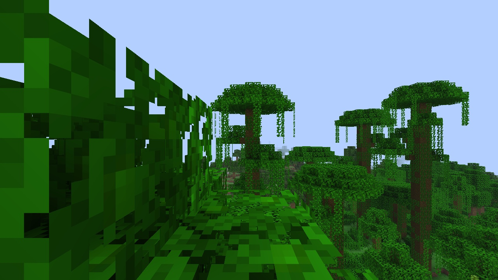
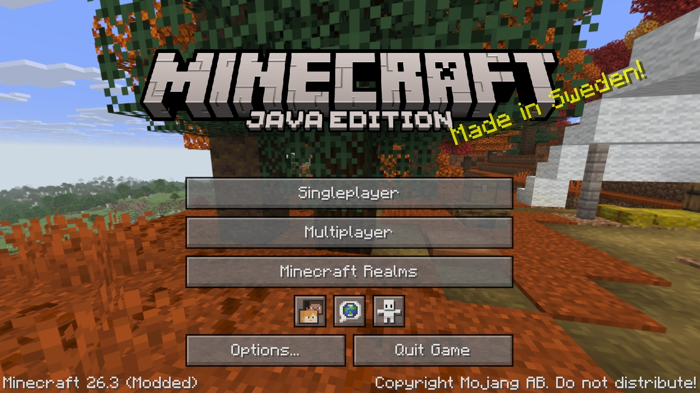
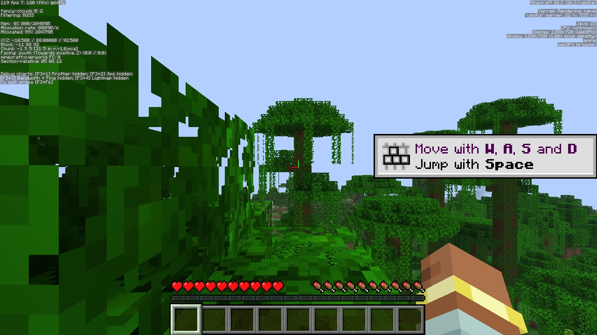
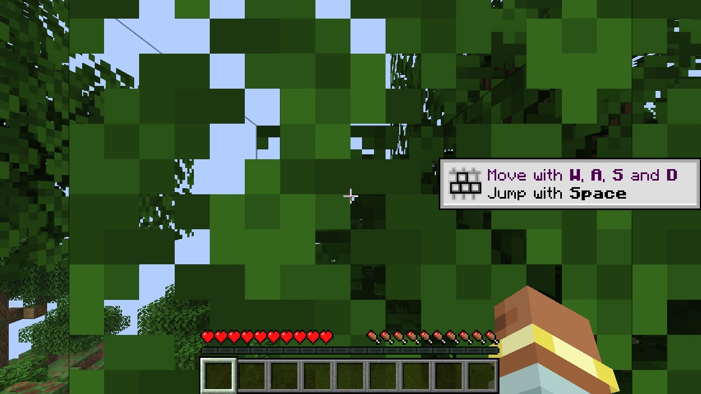

<p align="center">
  
</p>

<h1 align="center">Browsercraft</h1>

<p align="center">
  Minecraft: Java Edition, compiled to WebAssembly and rendered with WebGPU.
  It runs entirely in a browser tab at 120 fps.
</p>

<p align="center">
  
  
  
  
  
  <a href="LICENSE"></a>
</p>



Browsercraft takes the real Minecraft client and turns it into WebAssembly ahead of time. Nothing is rewritten by hand, and there's no Java applet, plugin or streaming server.

The world runs on a dedicated server in a second Web Worker, next to the client. Rendering goes through a WebGPU backend that replaces LWJGL and OpenGL. The only thing outside the browser is a small WebSocket-to-TCP bridge for joining multiplayer servers.

> [!WARNING]
> **Not affiliated with Mojang or Microsoft.** This repository contains no Minecraft code or assets. You bring your own copy of the game. The build output (`mc.wasm`) contains Mojang's code, so don't host or share it.

> [!NOTE]
> This is a research project and it's paused for now. Expect rough edges.

## What works

- **Singleplayer at ~120 fps.** Title screen, world creation and saving. The integrated server runs in its own worker, so world generation doesn't stall the frame loop.
- **The whole UI.** Every settings screen, F1/F2/F3/F5, advancements, statistics and zip resource packs such as Programmer Art.
- **Pause and save.** Esc freezes the world. *Save and Quit to Title* writes all chunks before the server stops.
- **Screenshots.** F2 downloads a PNG.
- **Multiplayer** on offline-mode servers, through the bundled WebSocket proxy.

Not done yet:
- Online-mode servers. Microsoft login, encryption and chat signing are partly built.
- Sound.
- Fabric mods.

| Title screen | F3 at 119 fps | A real server |
| --- | --- | --- |
|  |  |  |

## How it works

```
 Minecraft client.jar + libraries
            │
            ▼
 Prep (ASM)  ── rewrites bytecode: redirects, VarHandle/Unsafe, class-init order,
            │   generic signatures, Gson field access (no reflection in TeaVM)
            ▼
 TeaVM WasmGC ── "the bake", ~30 min, produces mc.wasm
            │
            ▼
 Browser ── main thread: canvas, input, WebGPU device
           ├─ client worker:  mc.wasm  →  gpu.js (WebGPU)  ·  io.js (OPFS)
           └─ server worker:  same mc.wasm as a dedicated server
                     ▲
                     └── MessagePort pipe between the two
```

| Folder | What's in it |
| --- | --- |
| `tool/` | `Prep`, `Gsg` and `Bake`, plus small patches to TeaVM itself |
| `rt/jdk` | JDK classes TeaVM lacks: crypto, concurrency, NIO bits |
| `rt/src` | TeaVM classlib fixes, LWJGL/SDL shims, the WebGPU backend, replacements for a few Minecraft classes |
| `rules/` | Method redirects applied by Prep |
| `web/game/` | Worker bootstrap, WebGPU command layer, OPFS file system, audio, patched TeaVM runtime |
| `naga-bc/` | [naga](https://github.com/gfx-rs/wgpu/tree/trunk/naga) built for wasm. Translates Minecraft's GLSL shaders to WGSL at runtime |
| `srv/` | Node server: static files, Mojang API proxy, WebSocket→TCP bridge, Microsoft device-code login |
| `web/launcher/` | Launcher UI for accounts and instances |

## Building

You need:
- A Linux machine with Docker for the bake (~20 GB RAM). Dependency analysis is single-threaded, so a fast core helps more than many cores.
- Node 20+ locally.
- A Chromium-based browser with WebGPU.

```sh
git clone https://github.com/nett911/browsercraft.git
cd browsercraft

python3 scripts/fetch.py 26.3        # client.jar + libraries into mc/
python3 srv/prep_data.py mc data     # game assets into data/

echo 'BC_HOST=user@buildhost' > .bake.env
bash b.sh prep                       # ~15 s compile check
bash b.sh                            # full bake, ~30 min
scp user@buildhost:browsercraft/w/out/wasm/mc.wasm web/game/
```

The build host expects `mc/` at `~/browsercraft/mc`. `BC_CPUS`, `BC_MEM` and `BC_XMX` in `.bake.env` set the container limits.

Run it locally:

```sh
cd srv && npm install && cd ..
BC_DEV=1 BC_ROOT=$PWD/web BC_DATA=$PWD/data PORT=8090 node srv/server.mjs
```

Then open <http://localhost:8090/game/>. `BC_DEV=1` skips the login and is for your own machine only. Microsoft login needs `MS_CLIENT_ID` from an Azure app registration.

`naga.wasm` is checked in. To rebuild it, run this in `naga-bc/`:

```sh
cargo build --release --target wasm32-unknown-unknown
```

## AI disclosure


All code, scripts and docs in this repository were generated by Claude (Opus 5.5) in Claude Code. That includes the bytecode rewriter, the TeaVM patches, the WebGPU backend and this README.

My part was the idea, the direction and the decisions, plus testing on real hardware. I didn't write the code by hand.

## License

[MIT](LICENSE) © 2026 nett911. Minecraft is a trademark of Mojang AB, and this project is not endorsed by or connected to Mojang or Microsoft.
